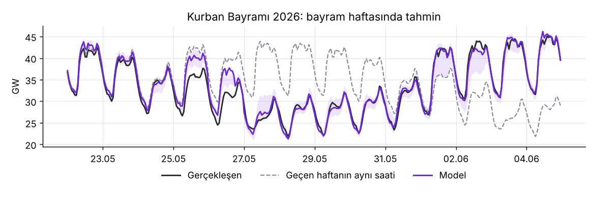
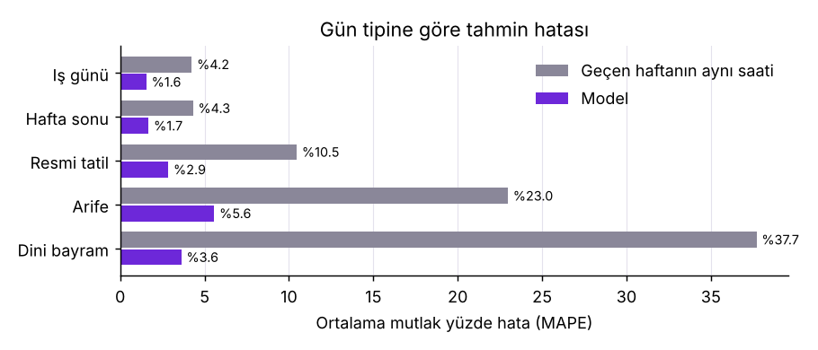
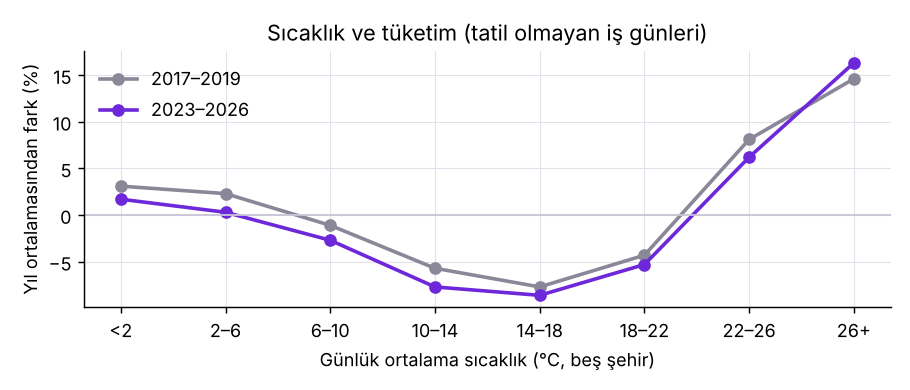

# Yarın Türkiye Ne Kadar Elektrik Tüketecek? Gün Öncesi Talep Tahmini

Türkiye'nin saatlik elektrik tüketimi (EPİAŞ, 2017–2026, 85.584 saat) için ertesi günün 24 saatini
tahmin eden bir model. Model 57 ay boyunca, her ay yalnızca o güne kadar bilinen veriyle yeniden
eğitilerek sınandı ve EPİAŞ'ta yayımlanan resmi gün öncesi tahminle (Yük Tahmin Planı) karşılaştırıldı.

**Rapor:** https://ozgurnurettinozturk.com/elektrik-talep-tahmini

## Sonuçlar

Test dönemi 1 Ocak 2022 – 30 Eylül 2026, 41.616 saat. Kural: D günü, en geç D−2 günü sonuna kadar
gerçekleşen tüketimle tahmin edilir.

| Yöntem | Saatlik hata (MAPE) | Ortalama hata (MW) |
|---|---|---|
| İki gün öncesinin aynı saati | %8,0 | 3.008 |
| Geçen haftanın aynı saati | %5,2 | 1.921 |
| Model, sıcaklık bilgisi olmadan | %2,1 | 816 |
| Model, sıcaklıkla (kusursuz hava tahmini varsayımı) | %1,7 | 642 |
| Resmi Yük Tahmin Planı (aynı saatlerde) | %3,0 | 1.160 |

- **Asıl fark tatillerde.** Dini bayramlarda "geçen haftayı kopyala" tabanı %38 yanılıyor, model %4.
- **Sıcaklık en çok yazın işe yarıyor.** Hava tahmini günde 2 °C şaşsa bile sıcaklığı kullanmak kullanmamaktan iyi.
- **Ham tahmin aralıkları fazla dar.** %80 hedefli aralık gerçekleşenlerin %65'ini içeriyor; geçmiş test
  hatalarıyla ayarlanınca (conformal) %81.
- **En kötü günler takvimle ilgili.** İdari izinle uzayan bayram tatilleri, sanayiye uygulanan planlı kesinti
  (Ocak 2022) ve depremler (Şubat 2023).

Resmi planla kıyas temkinli okunmalı: veri bugünkü haliyle kullanıldı (sonradan düzeltilmiş olabilir) ve
planın hangi saatte, hangi bilgilerle hazırlandığı bilinmiyor.





## Yöntem

- **Hedef:** megavat değil, saatin son bir haftadaki aynı saatlerin ortalamasına oranı (logaritması).
  Ağaç modelleri eğitimde görmediği seviyeleri tahmin edemediği için.
- **Özellikler:** aynı saatin 2, 3, 7 ve 14 gün önceki değeri, son haftanın seviyesi ve eğilimi; saat,
  haftanın günü, yılın günü; tatil türü, bayramın kaçıncı günü, arife, köprü günü, Ramazan; kıyas alınan
  günlerin tatil olup olmadığı; (ikinci modelde) beş şehrin sıcaklığı.
- **Model:** `HistGradientBoostingRegressor` (scikit-learn). Aralıklar için %10 ve %90 dilim modelleri.
- **Test:** her ayın başında o güne kadarki veriyle yeniden eğitim, yalnızca o ayın tahmini.

## Çalıştırma

```bash
pip install -r requirements.txt
python 01_veri_cek.py     # EPİAŞ hesabı ister (ücretsiz); data/ klasörünü doldurur
python 02_model.py        # özellikler ve geriye dönük test -> outputs/tahminler.csv (yaklaşık 15 dakika)
python 03_ozet.py         # outputs/summary.json ve grafikler
```

EPİAŞ kullanıcı adı ve şifresi çalışırken sorulur, hiçbir yere yazılmaz. Ham veri depoda yok.

## Sınırlar

- Sıcaklıklı sonuç gerçekleşen sıcaklıkla hesaplandı; gerçek hava tahminiyle hata bir miktar artar.
- Takvimde idari izinler yok.
- Sıcaklık beş şehrin düz ortalaması; nem, bulutluluk ve güneş enerjisi üretimi modelde yok.
- Model tek bir ayar takımıyla çalıştırıldı.

Veri: EPİAŞ Şeffaflık Platformu (gerçek zamanlı tüketim, yük tahmin planı), Open-Meteo (sıcaklık).
